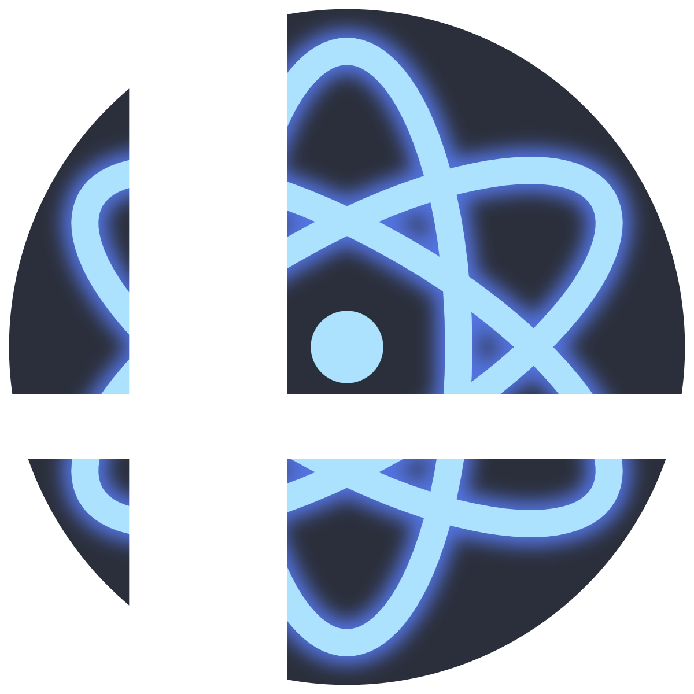

  

# SSBM Nucleus

Mod manager for Super Smash Bros. Melee. Download, organize, and install character and stage skins.

**Download:** [ssbmnucleus.net](https://ssbmnucleus.net) — the app auto-updates after install.

**Discord:** [Join](https://discord.gg/EAjJnccxgF)

This repository is the public home for **releases, issues, documentation, and source**.

## Source

Every release from 0.9.0 on is one commit here, tagged `v<version>`: the source of exactly what
that installer ships, plus the README, changelog and notices. Development happens elsewhere, so
there is no history between releases. Pull requests are welcome; they are copied over by hand.

SSBM Nucleus is licensed under the [GNU GPL v3.0](LICENSE). The combo state machine in
`app/backend/tracker/combos/combo_index.py` is a port of
[slippi-js](https://github.com/project-slippi/slippi-js) and keeps its LGPL-3.0 notice.
Third-party licences are in [THIRD_PARTY_NOTICES.md](THIRD_PARTY_NOTICES.md).

Three companion repos get a snapshot of the commit each release pins, tagged `nucleus-v<version>`:

| Repo | What | Licence |
|---|---|---|
| [ssbmNucleus/rigswap](https://github.com/ssbmNucleus/rigswap) | puts a downloaded 3D model on a fighter's rig (Randall's model import) | GPL-3.0 |
| [ssbmNucleus/HSDLib](https://github.com/ssbmNucleus/HSDLib) | fork of Ploaj's HSDLib / HSDRawViewer; the release carries its builds | MIT |
| [ssbmNucleus/m-ex](https://github.com/ssbmNucleus/m-ex) | fork of MexManager / MexCLI on the m-ex system; the release carries its builds | none upstream; see its README |

`app/utility/*.manifest.json` pin those releases, and `tools/build/fetch_native.py` and
`tools/build/fetch_rigswap.py` fetch them. All four repos are public, so no GitHub account is needed.
Setup is in [docs/dev/DEVELOPMENT.md](docs/dev/DEVELOPMENT.md).

The source carries no Nintendo game data. A few dev-only and game-derived files are left out of
this copy (test costumes, retail art, a commercial font), so some tests and previews need your own
game files.

## Features

- One-click skin downloads from the website
- Visual vault for organizing mods, CSPs, and stock icons
- Automatic CSP generation from DAT files
- Netplay safety validation
- Batch install skins
- Skin creator with live paint, texture import/export, and 3D preview
- Extras system — edit sword trails, lasers, shine, thunder, shadow ball, and other character-specific effects
- Pose manager — create and batch generate custom CSP poses
- Embedded 3D model and animation viewer
- Auto-generate Dolphin texture packs for unlimited skins per ISO
- Mod bundles (.ssbm) — one-click xdelta patches + texture packs
- XDelta patch creation for sharing modpacks
- First-run setup with auto-detection of Slippi and Melee ISO

## Requirements

- Windows 10/11 (64-bit)
- A legally obtained copy of Super Smash Bros. Melee (NTSC 1.02, `GALE01`)

SSBM Nucleus ships **no Nintendo game data**. On first run it extracts what it needs from the ISO you provide, on your machine. No game assets are distributed with the installer.

## Reporting bugs

Open an [issue](../../issues). Bug reports are much easier to act on with:

- the app version (Help → About, or the installer filename)
- what you were doing when it broke
- the log file — Help → Open Logs Folder

## Credits

Built with [MexManager](https://github.com/Ploaj/MexManager), [HSDRawViewer](https://github.com/Ploaj/HSDLib), and [Costume Validator](https://ssbmtextures.com/other-mod-types/costume-validator-by-ploaj/) by Ploaj

Built on the [MEX system](https://github.com/akaneia/m-ex) and Dynamic Alternate Stages by UnclePunch

## Not affiliated with Nintendo

Super Smash Bros. Melee is a trademark of Nintendo. This project is an independent, non-commercial modding tool and is not affiliated with, endorsed by, or sponsored by Nintendo or HAL Laboratory.
