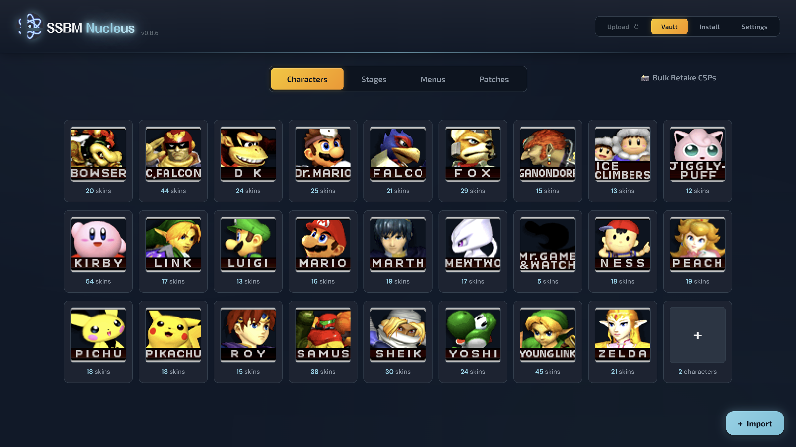

# SSBM Nucleus Guide

Updated September 13, 2026 for Nucleus 0.8.6.

SSBM Nucleus is a mod manager for Super Smash Bros. Melee. You collect skins, stages, music and other mods in a library, pick which ones go into your game, and Nucleus builds you an ISO. Your original ISO is never touched.

- **The website**, [ssbmnucleus.net](https://ssbmnucleus.net): browse mods and send them straight into the app with one click.
- **The desktop app**: this guide.
- **On your phone**, [tracker.ssbmnucleus.net](https://tracker.ssbmnucleus.net): your replay library, combos, stats and brackets, synced from the desktop. See [Tracker](08-tracker.md).

If Nucleus has made Melee modding easier for you, you can support its development at [patreon.com/cw/ssbmSc00p/membership](https://www.patreon.com/cw/ssbmSc00p/membership). Any paid tier, from $5/month, unlocks the phone app.

## Two modes

Click the **SSBM Nucleus** wordmark in the top left to switch.

- **Nucleus** is the mod manager. Most of this guide.
- **Tracker** is stats for your Slippi replays: combos, character stats, tournaments, and a phone companion. See [Tracker](08-tracker.md).

## Contents

1. [Install and first run](01-install.md)
2. [The basics](02-basics.md)
3. [Getting mods](03-getting-mods.md)
4. [The Vault](04-vault.md)
5. [Building your game](05-install-tab.md)
6. [Exporting an ISO](06-export.md)
7. [Slippi safety](07-slippi.md)
8. [Tracker](08-tracker.md)
9. [Settings](09-settings.md)
10. [Troubleshooting](10-troubleshooting.md)
