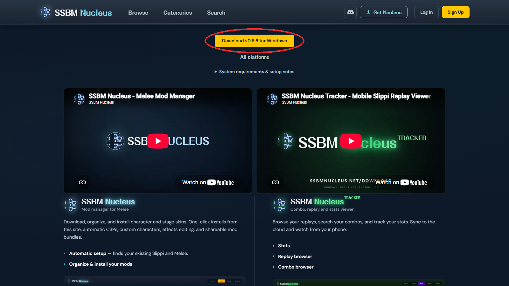
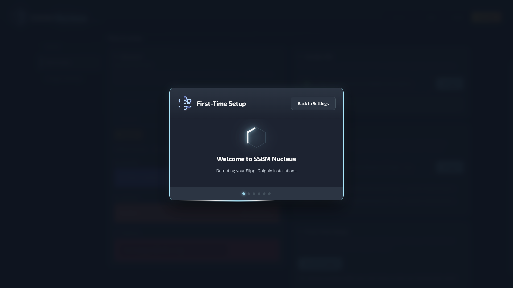
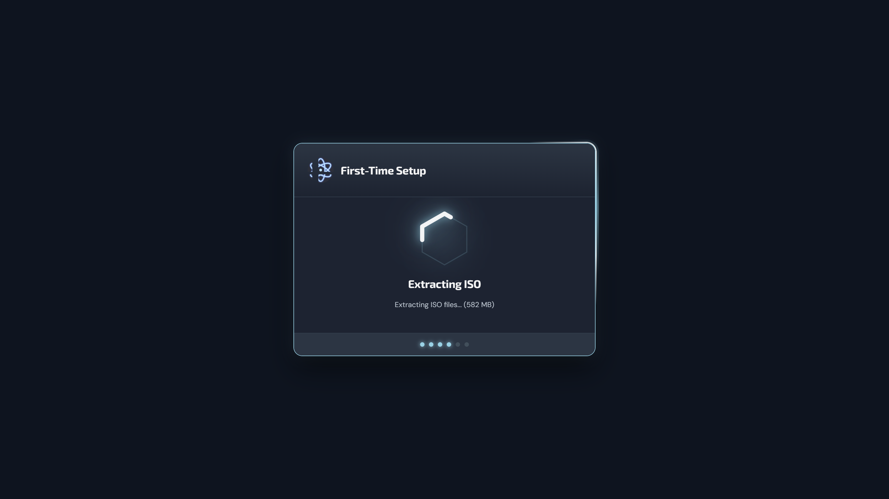

# 1. Install and first run

## Download

[ssbmnucleus.net/download](https://ssbmnucleus.net/download) has builds for Windows, macOS (Apple Silicon only) and Linux (AppImage).

## First run

The app needs two things the first time it opens.

### A clean Melee ISO

An unmodified **NTSC 1.02** ISO. Every build starts from it, and Nucleus never changes it. The app looks in your Slippi folders and usually finds it on its own; otherwise click **Browse**. A modded ISO is rejected.

### Slippi Dolphin

Used to test and launch builds. Detected automatically in most cases.

Setup then extracts what it needs from the ISO and drops you on the **Vault** tab.

> Both paths can be changed later in **Settings → Files & setup**.
