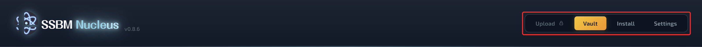
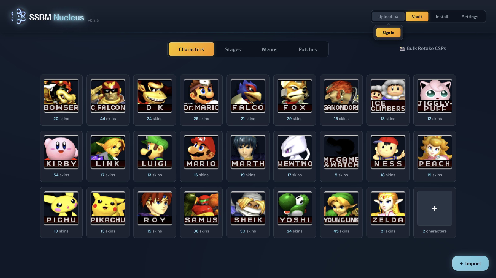
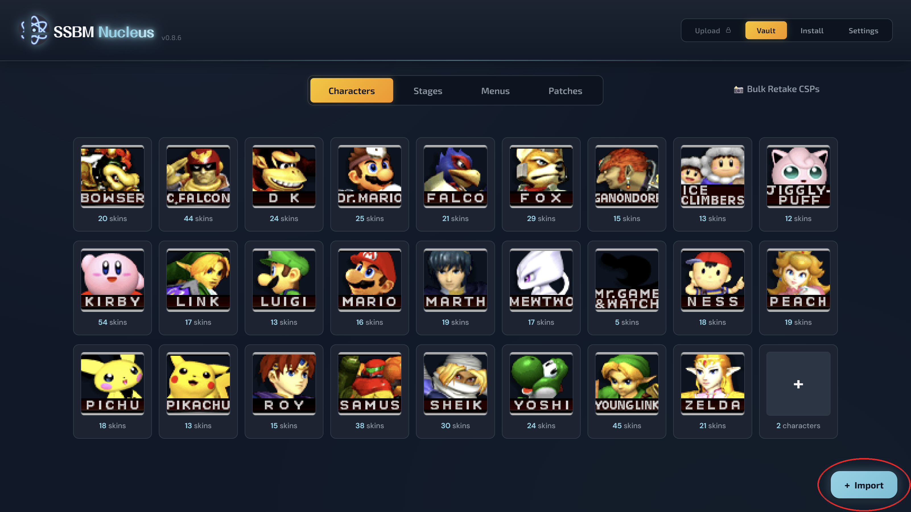

# 2. The basics

Click the wordmark in the top left to switch between Nucleus, Tracker, and Unlocked.
Unlocked is available on Windows. Open its **Nucleus Unlocked** card to install the game
client from the app. You need your own Melee 1.02 disc image and a processor with AVX2.
The **Vanilla** card starts Melee with nothing changed.

In Nucleus mode, the tabs across the top are **Upload**, **Vault**, **Install**, and **Settings**.

**Upload** unlocks when you sign in with a website account. Pick the skins, write a description, add screenshots, and post them to [ssbmnucleus.net](https://ssbmnucleus.net); the post gets an **Add to Nucleus** button so anyone can send it straight into their app.

## Vault versus build

- The **Vault** is your mod library. Everything you import lands here.
- A **build** (the app also calls it a project) is a game you are putting together from Vault mods. You export it as an ISO.

Nothing in the Vault is in your game until you install it into a build, and removing it from a build never deletes it from the Vault. Several builds can share one Vault.

So the whole flow is: [get mods](03-getting-mods.md) into the Vault, [put them in a build](05-install-tab.md), [export](06-export.md).

## Import

The round **Import** button in the bottom right of the Vault, or drop files anywhere on the window. Nucleus works out what each file is.

