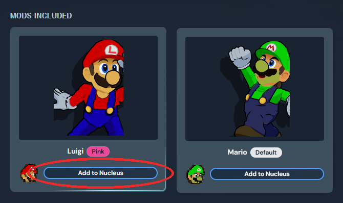
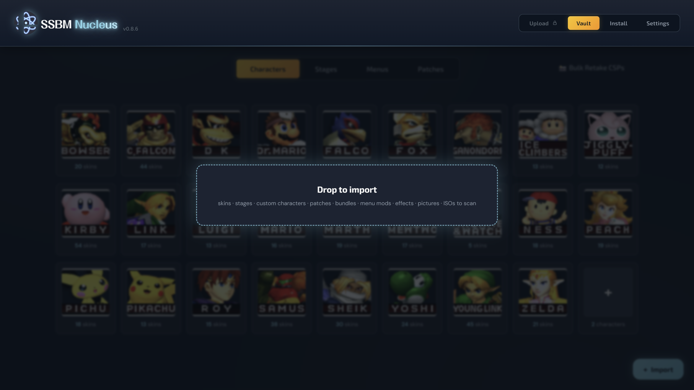

# 3. Getting mods

## From the website

Click **Add to Nucleus** on a post at [ssbmnucleus.net](https://ssbmnucleus.net). Confirm the browser's prompt to open the link in SSBM Nucleus, and the mod lands in your Vault under its character or stage. This works with the app closed too.

If nothing happens, download the archive and drop it on the app instead.

## From files

Click **Import** or drop files onto the window. Nucleus takes:

- **.zip**, **.7z** and **.rar** archives, including archives of archives.
- **Loose .dat / .usd** costume or stage files.
- **.xdelta** patches, filed under Patches.
- **.ssbm** bundles, a whole build in one file. See [Exporting an ISO](06-export.md).
- **.iso / .gcm**, which starts an ISO scan. See below.

A mod that comes without a portrait gets one rendered; one without a stock icon gets one made to match its colours.

Every import is checked for [Slippi safety](07-slippi.md) on the way in. Bulk imports skip duplicates and end with a summary.

## From an old modded ISO

Import a modded `.iso` or `.gcm`. Pick what to look for (skins, stage variants, custom characters, custom stages) and click **Scan ISOs**. Nucleus finds everything that isn't vanilla and isn't already in your Vault, renders a portrait for each, and lets you choose what to keep.

## From a bundle

A **.ssbm** bundle is a build's patch plus its HD portraits. Importing saves it under **Vault → Patches → Bundles**; **Play** builds the ISO from your clean Melee ISO, sets up the HD textures, and launches Slippi Dolphin. Its skins and stages are not added to your libraries.
