# 4. The Vault

Four pages, switched with the buttons under the tabs: **Characters**, **Stages**, **Menus**, and **Patches**.

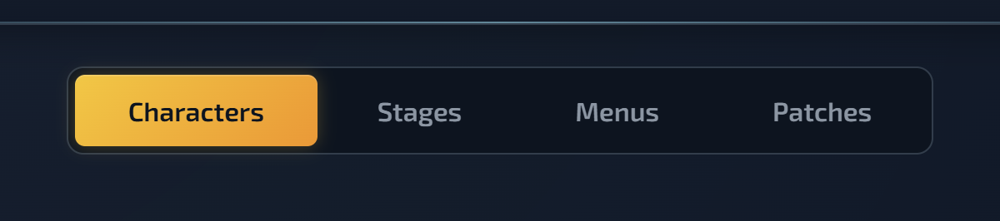

## Characters

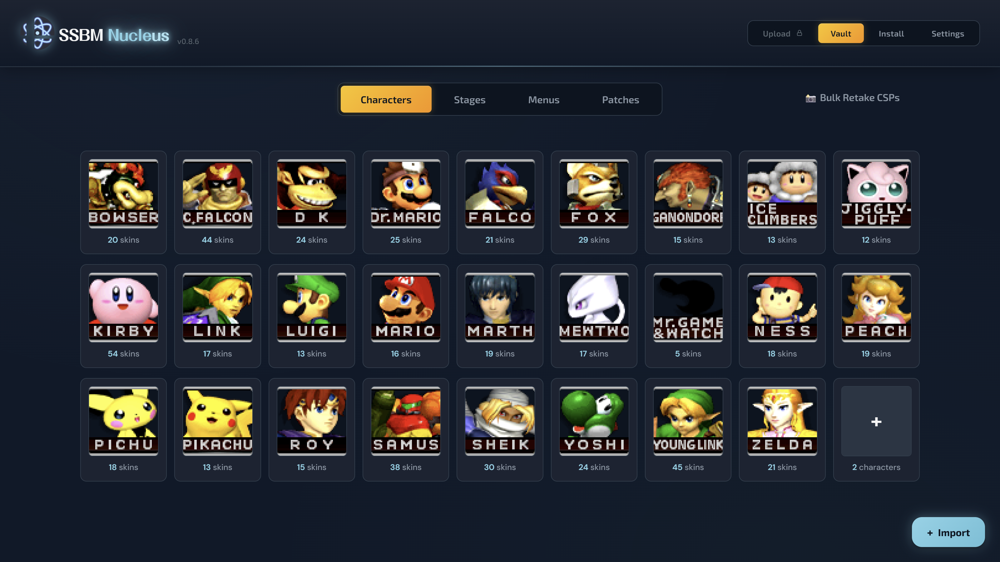

Click a character to see their skins.

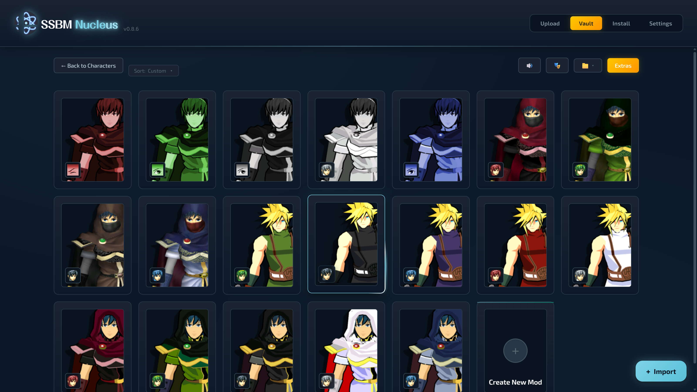

- **Drag** cards to reorder them (in **Custom** sort), or right-click to send one to the top or bottom.
- **Sort** A–Z, by date, or by colour.
- **Folders** group skins. Drag skins in and out.

### Editing a skin

Click a card to open the editor. Click the name to rename it. Every change applies immediately.

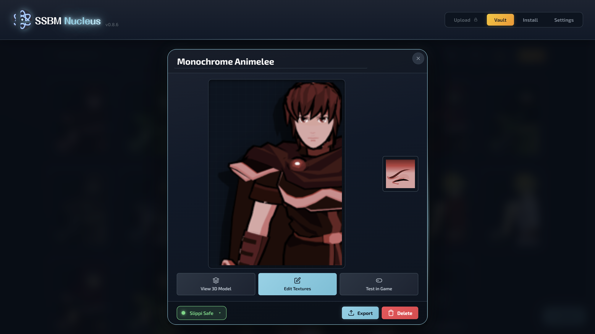

- **Portrait** and **stock icon**: replace with your own image or have Nucleus generate one. Stock icons come in two styles, a recolour of the vanilla pixel icon or a 3D render of the model's head. Hover either image for **Export**.
- **Slippi safety**: retest or override. See [Slippi safety](07-slippi.md).
- **View 3D Model**, including in motion with the character's real animations.
- **Test in Game**: play the skin on Battlefield in a temporary ISO. See [Test in game](05-install-tab.md).
- **Delete**.

### Portraits

Portraits are the character select pictures (CSPs). Hover a skin's portrait for **Portraits**, **Pose** and **Retake CSP**.

**Portraits** shows the original and any alternates. Click one to make it active, add an alternate from an image, or replace the original. An HD tag marks portraits that also have a 4x copy for texture packs.

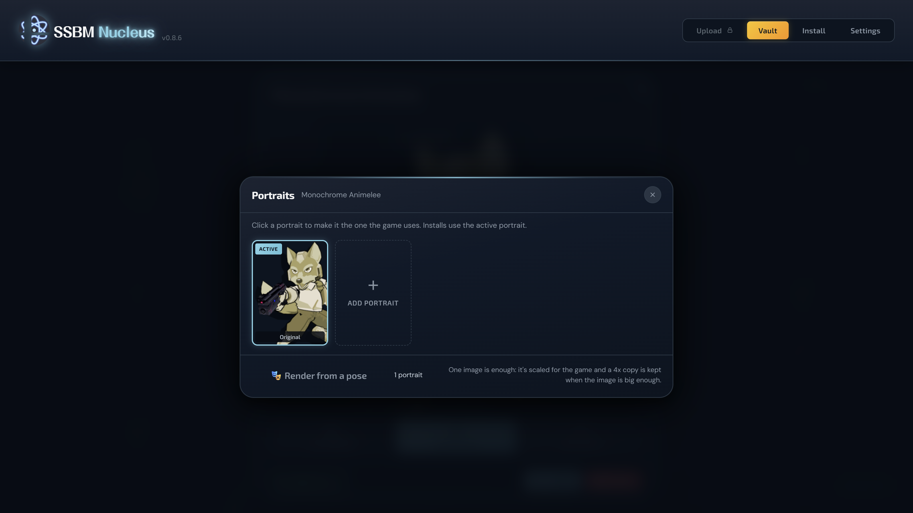

**Poses** change how portraits look. **Create New Pose** opens the character in a 3D viewer: pick an animation and frame, adjust the camera, and save. The **Model** button there swaps the vanilla model for any skin in the vault.

**Pose** on a skin's portrait takes the picture with any saved pose and makes it the one the skin shows, or opens the pose maker on that skin's own model.

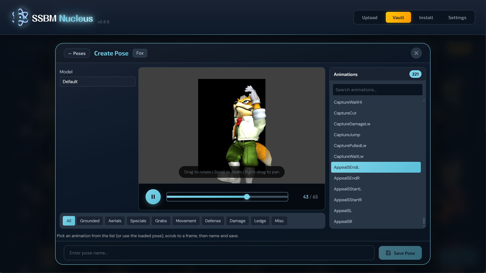

Click a saved pose to render every skin of that character with it, so the whole select screen matches.

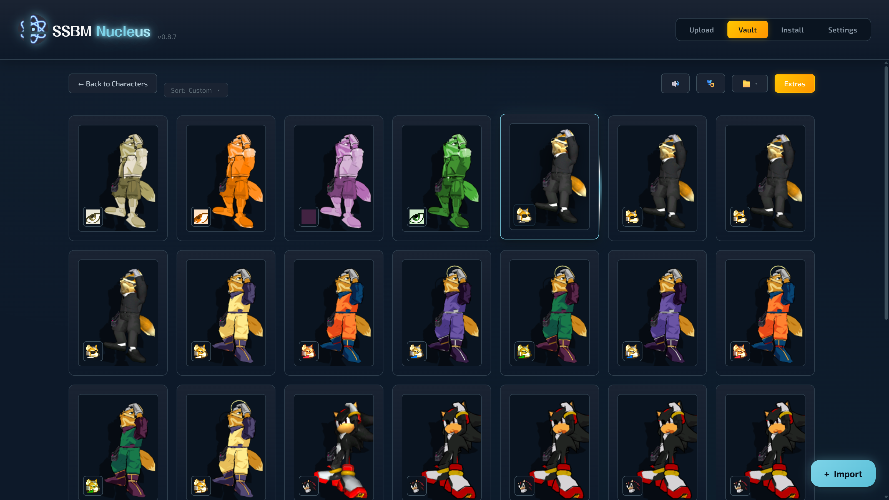

**Bulk Retake CSPs** above the character grid renders portraits across every character at once, with presets for skins missing a portrait or an HD portrait. You review each before/after pair before anything is saved.

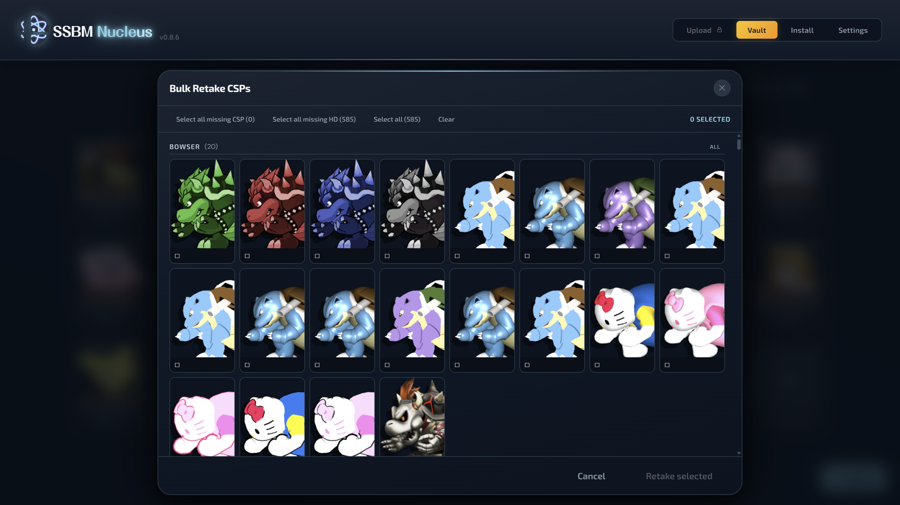

### Skin Creator

**Create New Mod** on a character's page. Start from any skin or a vanilla costume.

- **Recolour** with the palette: it groups the costume's colours and shifts each group's hue while keeping the shading. **Materials** edits material colours, opacity and shininess.
- **Paint** on any texture with pencil, eraser, bucket and a **replace** tool that swaps every pixel of one colour across the texture. Select an area to keep tools inside it. Or export a texture as PNG, edit it elsewhere, and import it back.
- **Layers** with opacity and blend modes, kept for the editing session and flattened on save.
- **Reference** holds a picture you are matching; click it to eyedrop a colour or pull out its palette.
- **Preview** on the real 3D model, in motion. Picking a texture flashes it on the model so you can see what it paints.

Saving makes a new skin in your Vault with its own portrait and stock icon. Ice Climbers show Popo and Nana together, each with their own texture set.

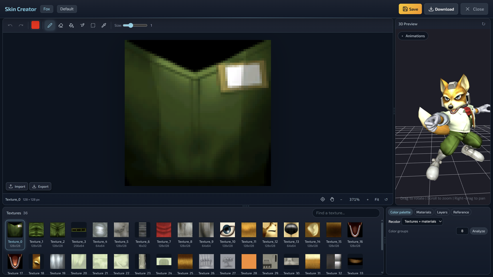

Mr. Game & Watch has no textures, so his page has **Create New Color** instead: a fill and an outline colour.

### Effects

**Extras** on a character's page recolours their effects: Fox's laser and shine, Falcon's fire, Mario's fireballs, sword trails, and so on.

Pick an effect and **Create New Mod**. Click a part of the diagram and set its colour; the in-game picture highlights the part you're on. **Recolor whole effect** shifts everything at once.

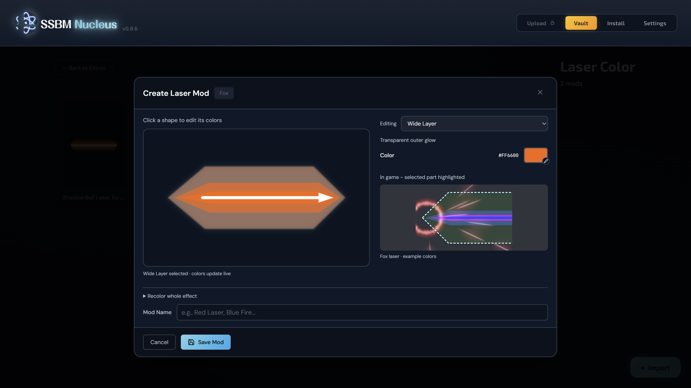

Saved effects install into a build like anything else. A few are shared between characters (Fox and Falco share their laser); the editor says so.

## Stages

The six tournament stages each hold a set of alternate looks, called variants. Everything else is under **More Stages**.

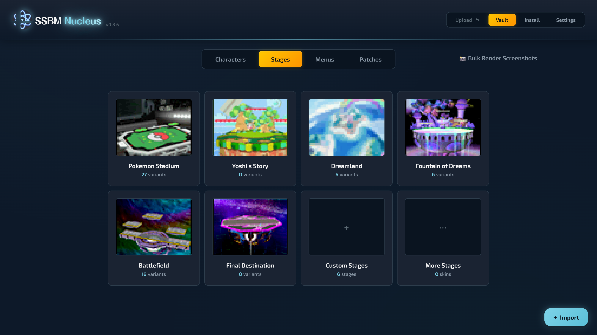

Click a stage, then a variant to edit it: screenshot, name, and a Slippi status you set yourself. A mod that came without a screenshot gets one from **Bulk Render Screenshots** above the grid, which draws every variant you tick offline in about a second each. **Capture Screenshot** on a single variant does the same through a real game boot.

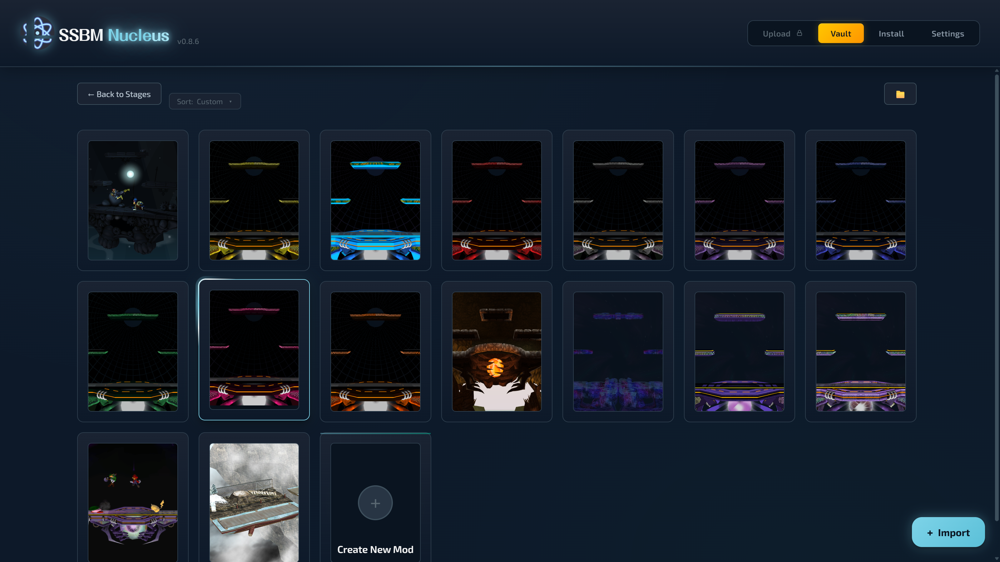

In game, every installed variant is available on its stage; you hold a button on the stage select to pick one. See [Building your game](05-install-tab.md).

### Stage Creator

**Create New Mod** on a stage's page opens the stage in the creator. Paint or recolour its textures with a live 3D preview and its animations playing. Saving makes a new variant in your Vault.

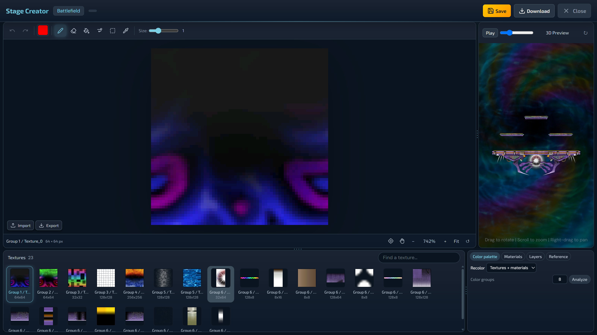

### More Stages

Skins for the 23 stages outside the tournament six live here and import like anything else. Installing one replaces that stage's look, or **Add as new stage** keeps the original and adds the skin as its own stage-select entry.

### Custom stages and custom characters

Whole new stages and fighters (Sonic, Wolf, Giga Bowser and friends) get their own slot on the select screen. Their pages are behind the **Custom** card on the Characters and Stages grids. Giga Bowser is built in; click his greyed-out card once to set him up.

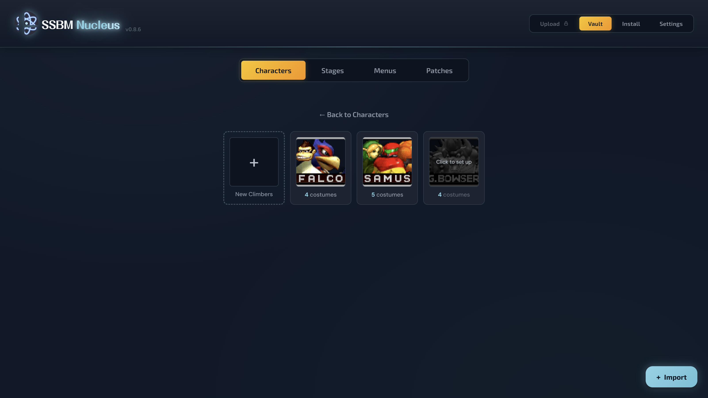

**New Climbers** builds an Ice Climbers-style pair from any two fighters: pick a **Leader** and a **Partner** and click **Create Pair**. You control the leader and the partner follows. Combinations the game can't handle are dimmed with the reason. The pair is an ordinary custom character from then on.

## Menus

Menu mods change the select screens and the in-game HUD. Pick a kind in the sidebar; each has its own grid.

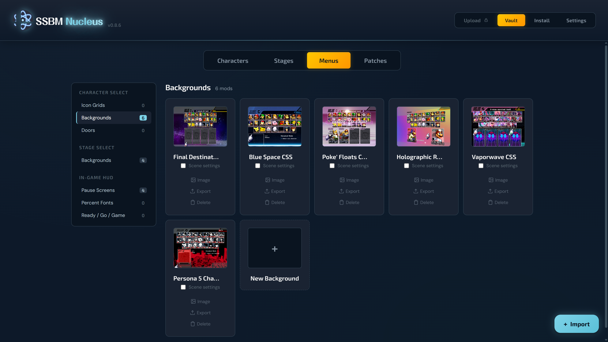

- **Character Select**: icon grids, the background, and the player-port doors.
- **Stage Select**: the background.
- **In-Game HUD**: pause screen, damage percent font, and the Ready / Go / Game graphics.

Install one from the Menus view of the Install tab (see [Building your game](05-install-tab.md)). In game it replaces that screen outright:

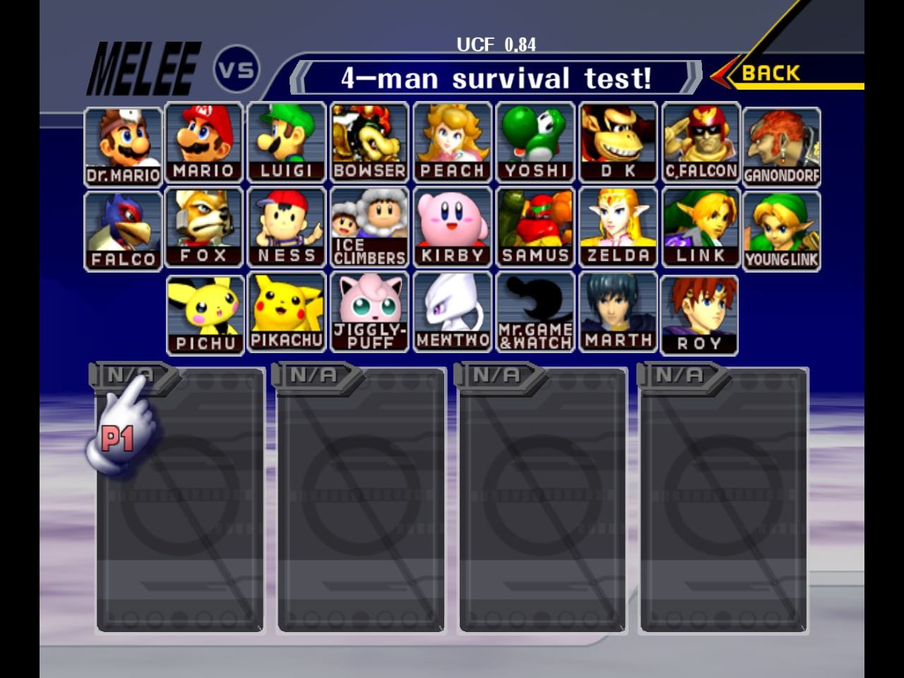

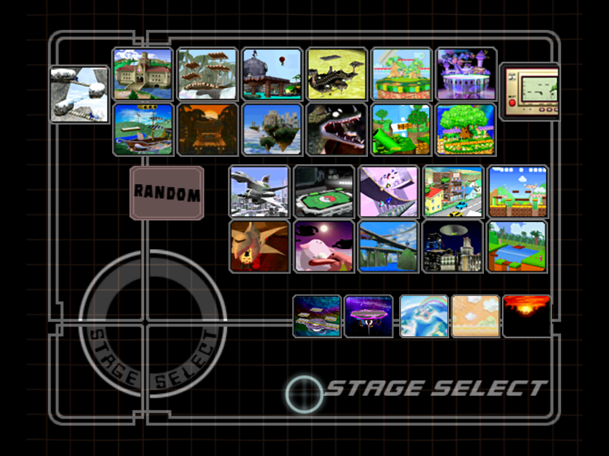

Hover a card to rename, swap its preview, export or delete. Icon grids, pause screens and fonts open an editor when clicked, and the **+** card at the end of each kind starts a new one from the vanilla textures. Doors and backgrounds take an image file.

## Patches

Patches are whole builds stored as small `.xdelta` files. Import one someone shared, or **New Patch** makes one from a modded ISO you have. **Play** builds and launches it; **Export ISO** saves it. To add your own skins on top of a patch, start a build from it; see [Building your game](05-install-tab.md).

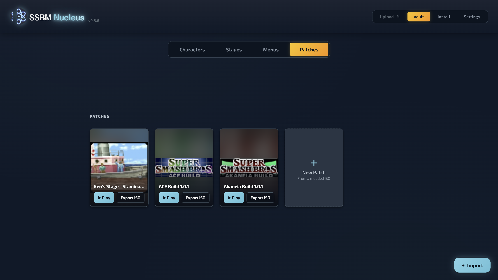

**Bundles** live here too. **Play** builds the game, sets up its HD textures, and launches Dolphin. Open a bundle to rename it, change its cover, or export the `.ssbm`.

## Sounds

Every character's page has **Sounds**. Make a sound pack, preview any of the character's sounds, replace one with your own audio file, and install the pack into a build.

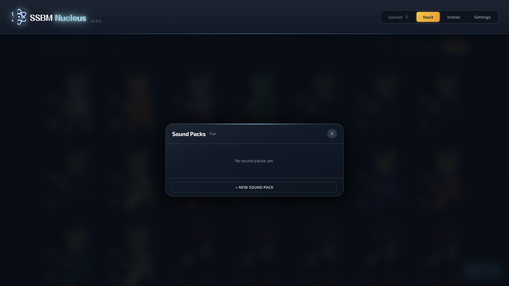

## Backing up

**Settings → Storage & backups → Vault Backup & Restore** saves the whole Vault as one zip. Restore with **Merge** or **Replace**.
