# 5. Building your game

The **Install** tab is where Vault mods go into a build.

## Start a build

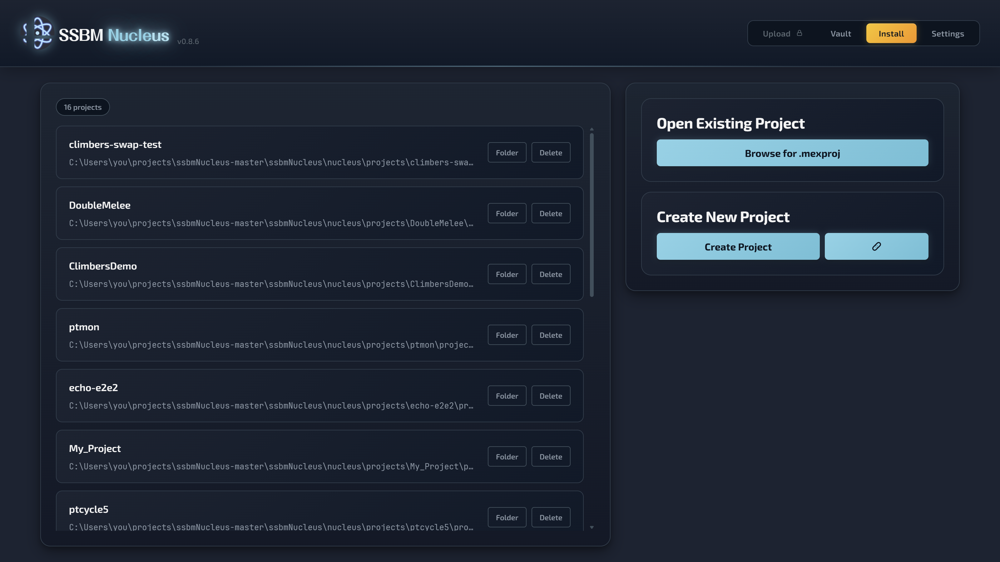

**Create New Project** makes a build from your vanilla ISO. Name it and wait for setup.

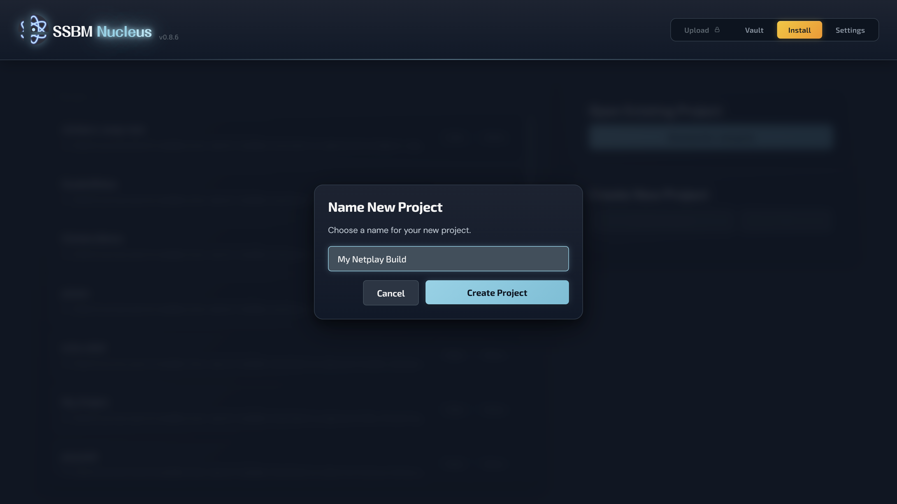

### Starting from a patch

The small button beside **Create New Project** starts a build from a patch in your Vault instead of from vanilla. Pick the patch and the new build opens with everything that patch contains already installed, so you can add your own skins, stages and codes on top and export the result as its own ISO, patch or bundle.

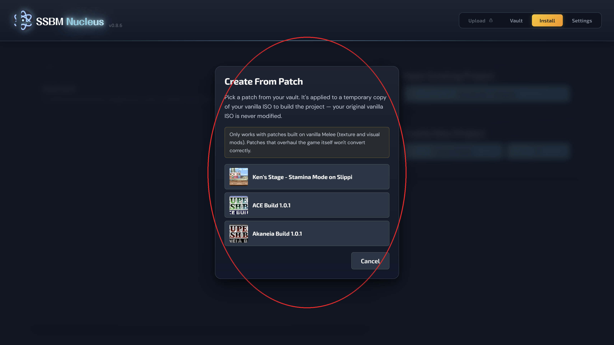

**Open Existing Project** opens a `.mexproj` from disk.

## Fighters

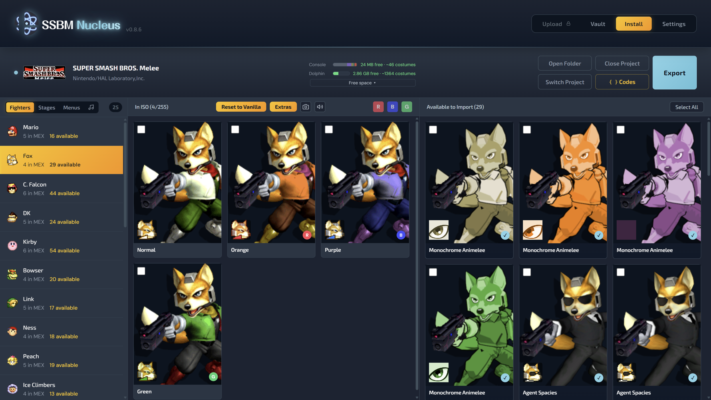

Pick a character on the left. The middle column is what's in the build; the right column is what's in your Vault but not in the build yet. Tick skins, across as many characters as you like, and **Import All Selected**.

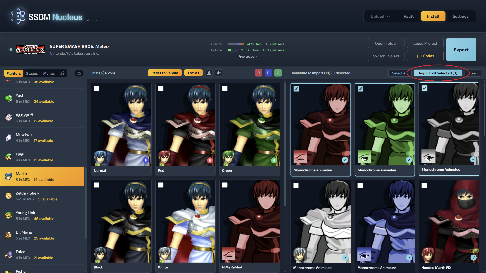

In the build column:

- **Drag** to reorder. This is the order you cycle through in game.
- **✕** removes a costume from the build. It stays in your Vault.
- **Team colours** picks the costume for red, blue and green teams.

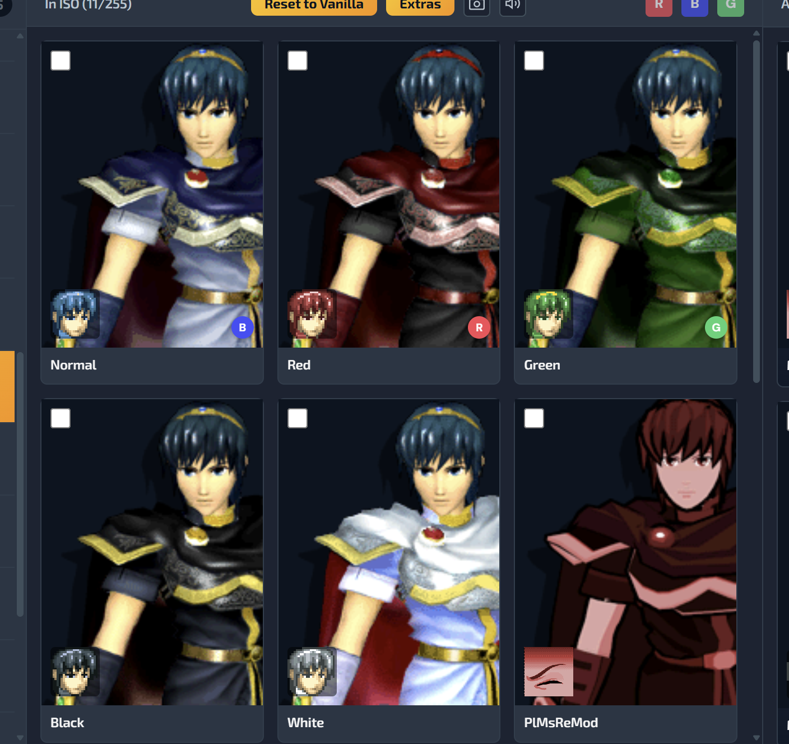

**Apply pose** re-renders every portrait in this column, vanilla costumes included, in one of your saved poses.

**Add Character** puts a custom character from your Vault into the build. Zelda and Sheik are linked, so their lists are edited together.

Large builds can run out of portrait memory; see [Exporting an ISO](06-export.md).

## Stages

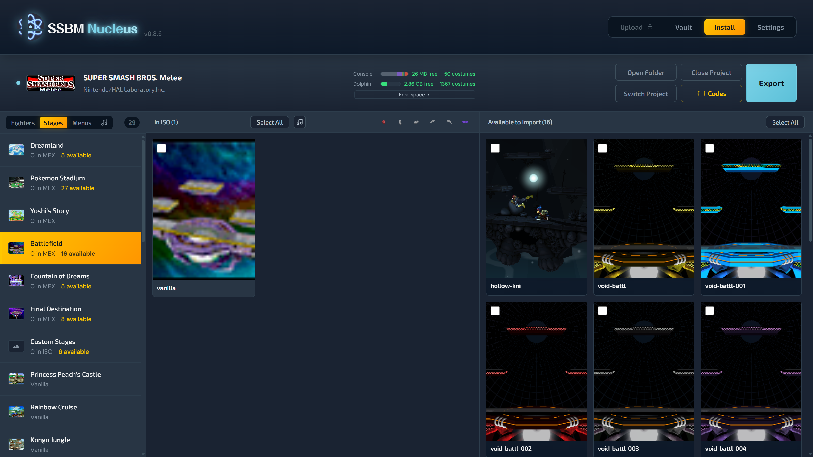

Each tournament stage lists the variants in the build. Install them from your Vault the same way as skins. The original stage is always kept as **Vanilla**.

To pick a variant in game you hold a button on the stage select. To assign buttons, click one of the button icons above the list (**B**, **X**, **Y**, **L**, **R**, **Z**), then click the variant. Click a variant's badge to clear it. With no button held the game picks at random from everything installed, so give **Vanilla** a button if you want to be able to choose it.

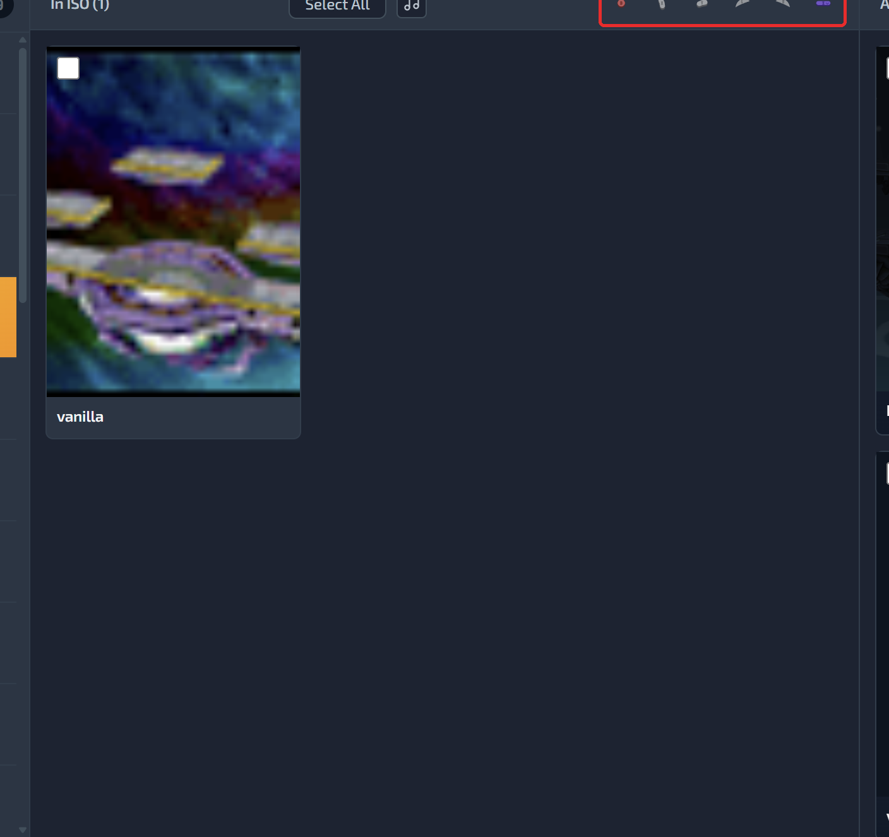

The music note on a stage opens its **playlist**: add WAV, MP3, OGG, M4A, FLAC, HPS, BRSTM or DSP files and set how often each plays. **Edit loop** has a player with the loop points; **Use playhead** sets the loop start from wherever you paused. **Restore Vanilla Music** puts the original playlist back.

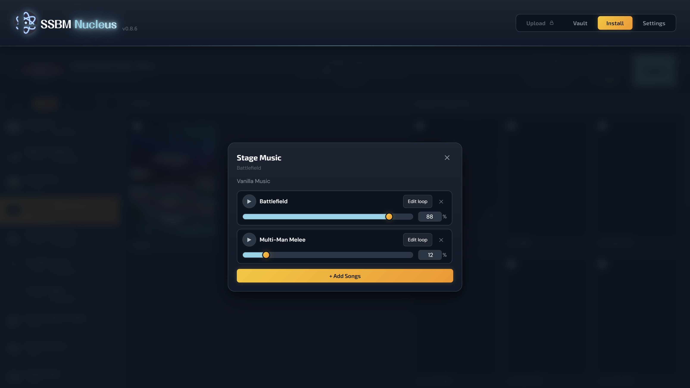

**Custom stages** have their own panel. The **More Stages** entries follow the tournament six: install a skin to replace the original, **Add as new stage** to keep both, or **Restore Vanilla**.

## Menus

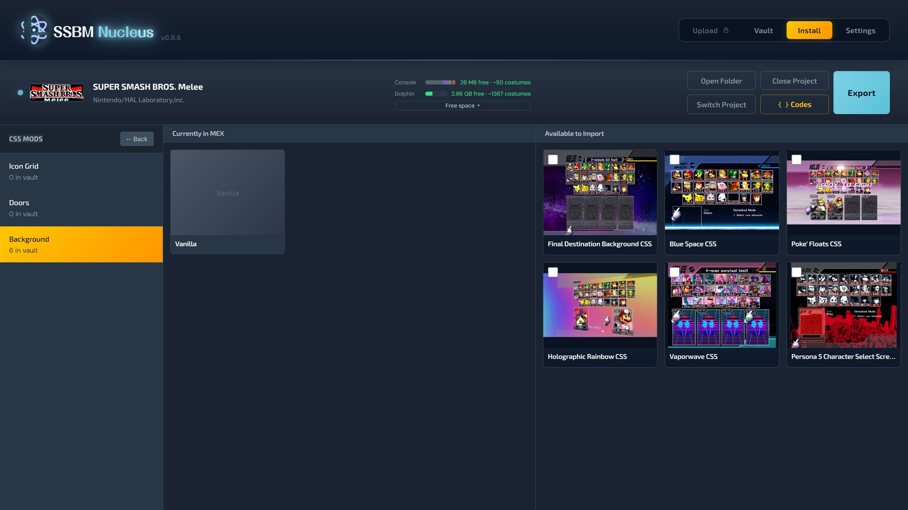

Pick a screen, then the part of it you want to change, and install a mod from your Vault; the current one shows at the top, with **Vanilla** to go back. **Edit Layout** on the character and stage select lets you drag the icons around. The music note next to the section tabs is the **menu music** playlist.

A custom character-select background or icon grid shares memory with the character portraits. If a build crashes on that screen after installing one, see [Portraits and memory](06-export.md).

## Codes

**Codes** is the Gecko code manager for this build: widescreen, UCF, camera tweaks and so on.

**In this build** is what's applied; tick, untick, or ✕ to remove. **Add codes** has a search box and your code library, pre-loaded with the community set and Nucleus's own codes like Now Playing; **Add** puts a code in the build and **Add all m-ex defaults** brings in the standard set. **Paste codes** takes raw hex, an INI block, or a messy forum copy-paste and picks the codes out.

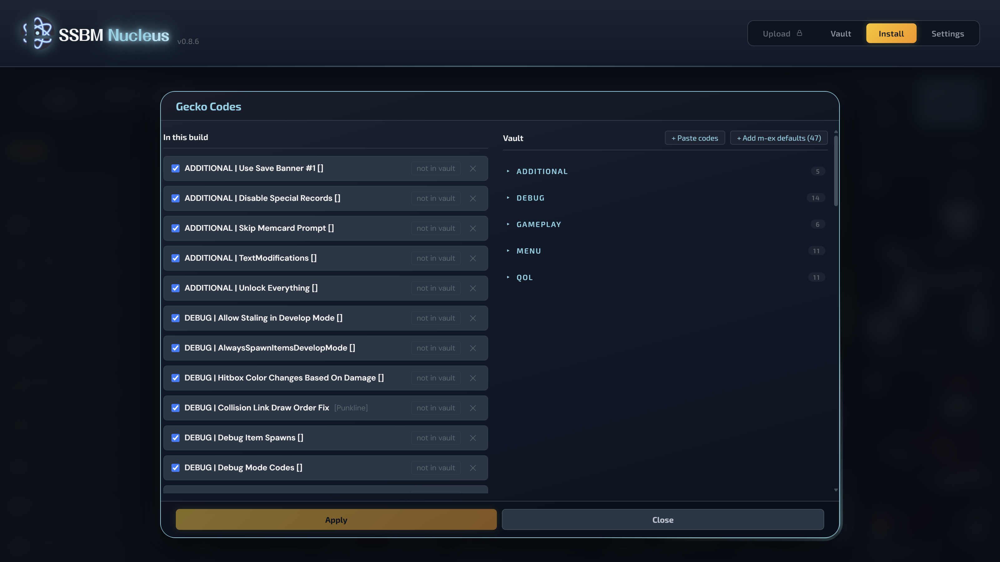

Nothing changes until you click **Apply**. **Skip Slippi SSS** is on in every build by default. Turning it off breaks the ISO on Slippi Dolphin (it crashes at the stage select), so only untick it for a Slippi Nintendont (console) build that crashes there. A new build also starts with **Now Playing**, which shows the song's name in the top-left corner when a match starts; untick it if you don't want it, or add it to an older build from **Quality of life** in the code list.

## Test in game

**Test in Game** on a skin, stage variant, custom character or custom stage builds a temporary ISO and plays it without touching your build. Close any Dolphin you already have open first. When it says **Ready to play — port 1**, use your port 1 controller. Skins and characters load on Battlefield; stage tests use Mario. **Stop** or close the Dolphin window when you're done.

On Windows the game shows inside the app, with **Open Dolphin window** if you want it separate. The test uses its own Dolphin setup and never goes online.

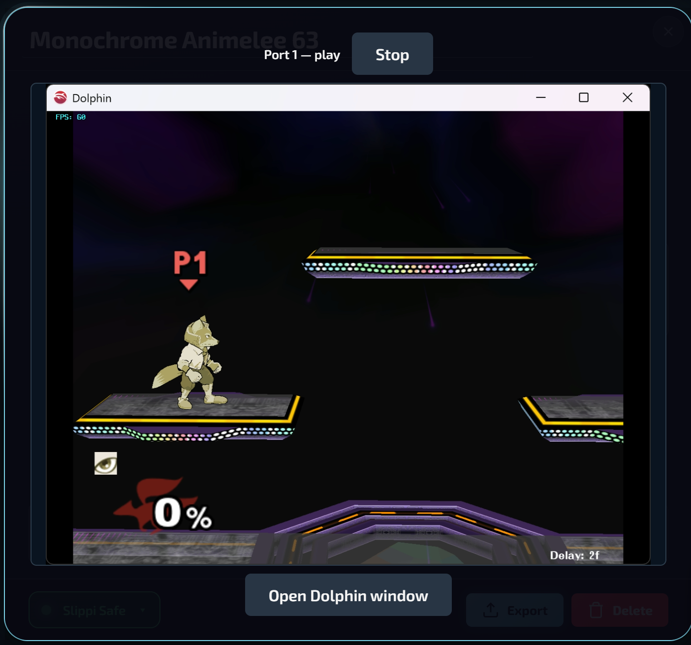
