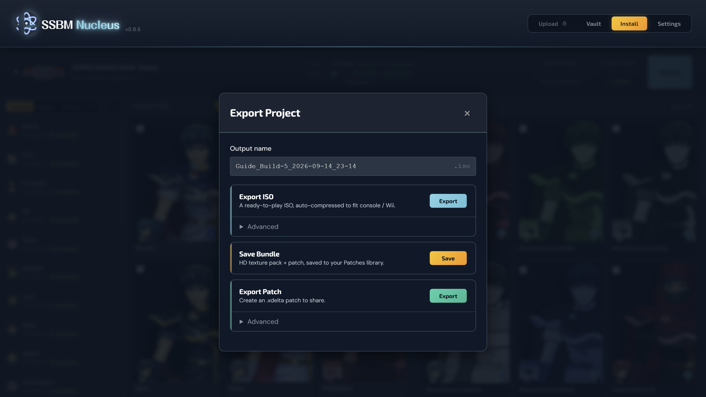
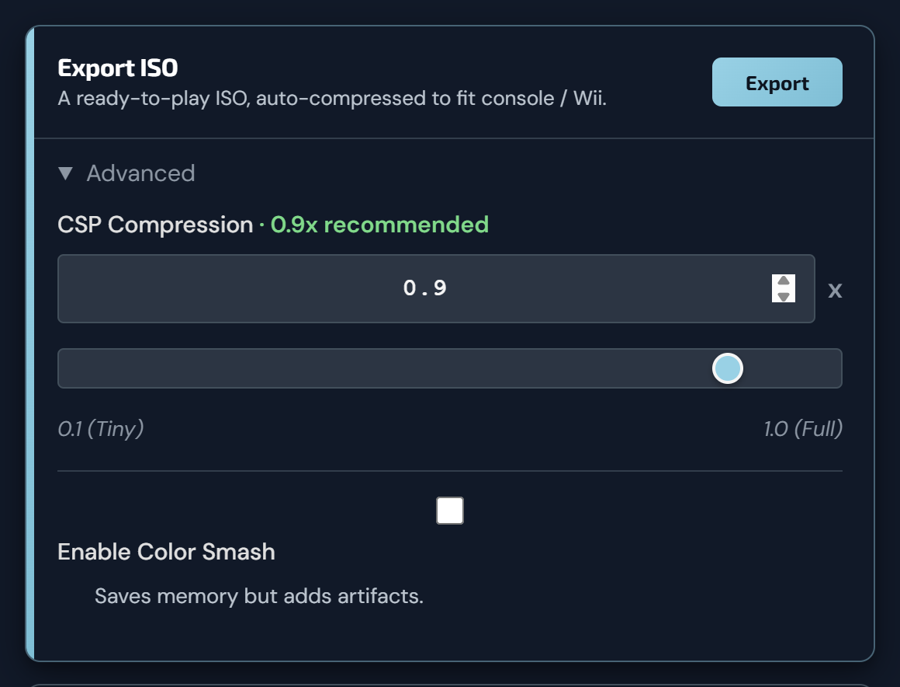

# 6. Exporting an ISO

Click **Export** at the top of the Install tab.

## Pick an output

- **Export ISO**: a playable game. Open it in Slippi Dolphin.
- **Export Patch**: an `.xdelta` that turns a vanilla ISO into your build.
- **Save Bundle**: an `.ssbm` with the patch and HD portraits together, saved to your Patches library. Whoever you send it to imports it and clicks **Play** under **Vault → Patches → Bundles**, and Nucleus builds it against their own clean ISO.

Send the patch or the bundle. Never share the ISO itself.

## Portraits and memory

Full-size character portraits take up memory on the character select, and too many of them crash it. Nucleus picks a portrait compression for the number of costumes in your build, so a normal export needs nothing from you.

The one time to set it yourself is a build with a menu mod. A custom character-select background or icon grid uses some of the same memory, so a build that was fine on the vanilla menu can crash once the mod is installed. If that happens, open **Advanced** on the ISO or Patch card and lower **Compression** a step. **1.0** is full size; lower is smaller and blurrier. **Color Smash** squeezes further at a cost in quality.

**HD portraits.** Bundles put tiny placeholders in the ISO and have Dolphin load full-size portraits from a texture folder, which Nucleus sets up for you. Dolphin only; a console can't load them.
