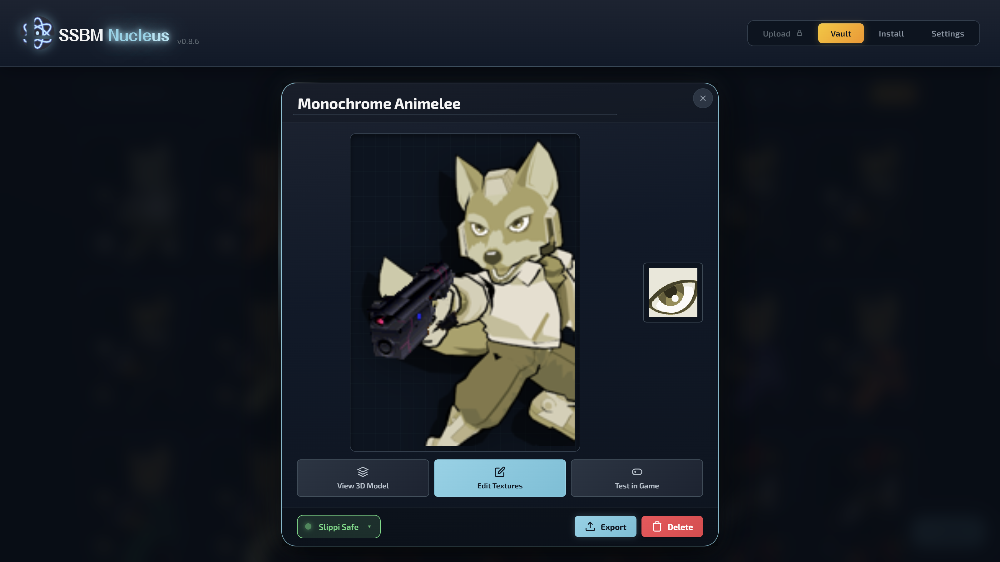
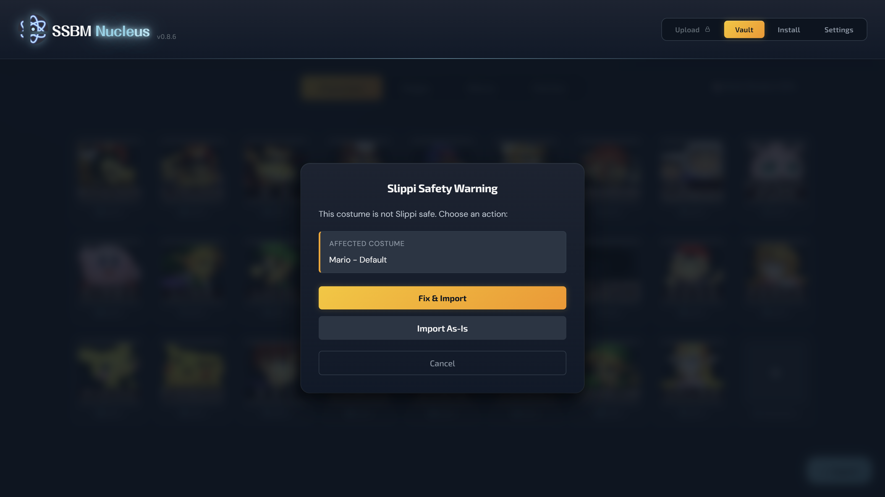

# 7. Slippi safety

A costume that changes the character's skeleton can desync a Slippi match. Nucleus checks every skin as it enters your Vault and shows the result on its card. It does not check codes or other mods in your build.

When a skin fails the check on import, Nucleus asks:

- **Fix & Import** repairs the differences it can, rechecks, and imports the result. Bulk imports do this automatically.
- **Import As-Is** keeps the file and marks it **Not Slippi Safe**: use it offline.

From the skin's editor you can **retest**, **Fix** later, or override the label by hand; an override changes the label, not the file.

Stage variants aren't checked automatically. Set their status yourself in the variant's editor.
