# 8. Tracker

Click the wordmark in the top left to switch to **Tracker**. It indexes your Slippi replays for playback, combos and stats. All of that is free and local.

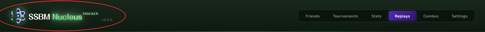

On **Replays**, point it at your replay folder if it wasn't detected, and add any other connect codes you play under.

All of it goes to your phone too — see [Nucleus on your phone](#nucleus-on-your-phone) at the end of this chapter.

## Replays

Search your games by character, opponent, stage and result, then click one.

**Lite** plays it in the app as a 2D view, no Dolphin: play, seek, jump between conversions, save a GIF.

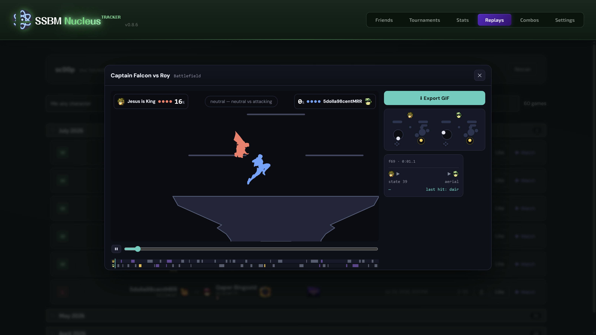

**Watch** plays the real replay in Dolphin with Vault skins of your choice on each player and a stage variant, and can record it. On Windows, Dolphin shows inside the app.

## Combos

Combos found in your replays. Filter by character, opponent, move count and damage, or **Kills only**. Multiple hits from one move count as one move.

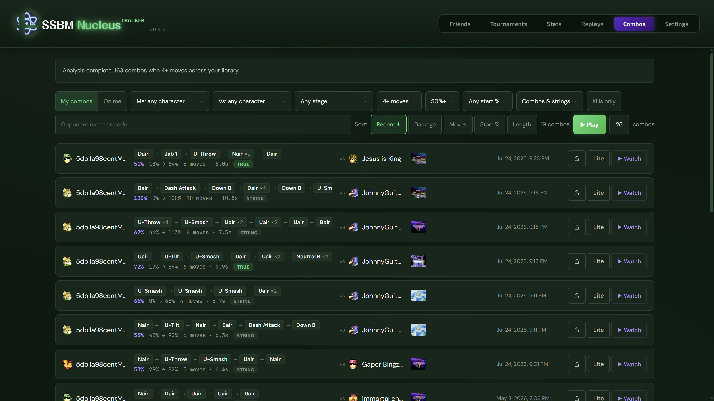

## Stats

Win rates, matchups, stage results and character-specific stats, with baseline comparisons where baseline data exists.

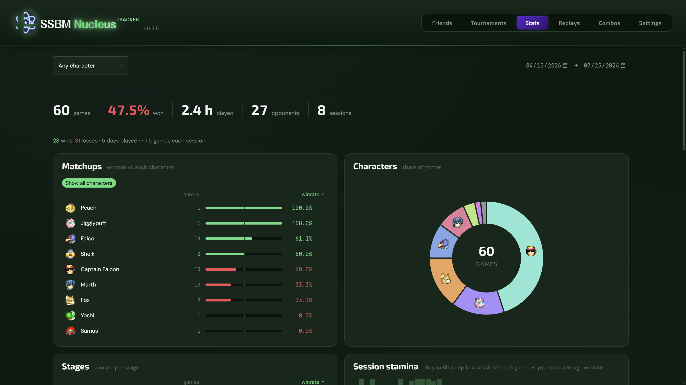

## Tournaments

Link your start.gg profile (**Link start.gg** on the page, or **Settings → Files & setup → Account**). Nucleus pulls your brackets and matches your replays to your sets.

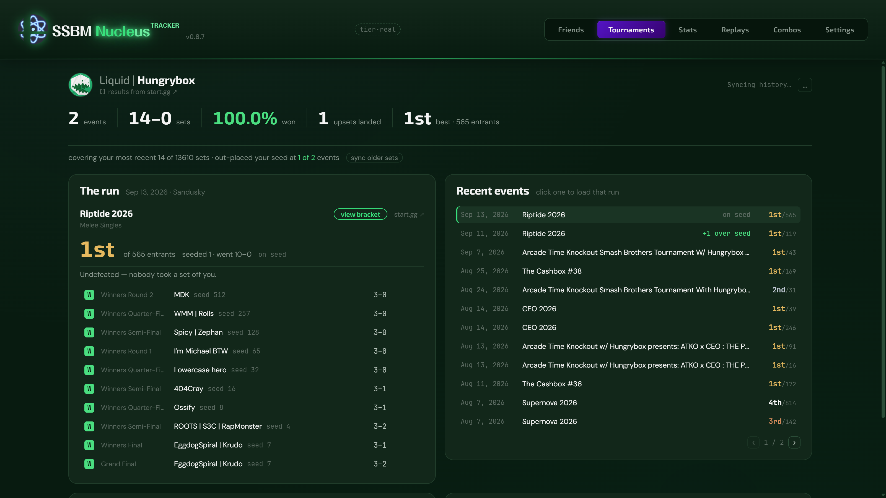

## Share

**Share** makes a public replay link that plays in a browser, no account or app needed to view. Sharing needs a linked Patreon account; the free tier is enough. Combos need at least 4 moves to be shareable, and an eligible combo can be **Set as profile combo**.

A shared replay, as anyone who opens the link sees it:

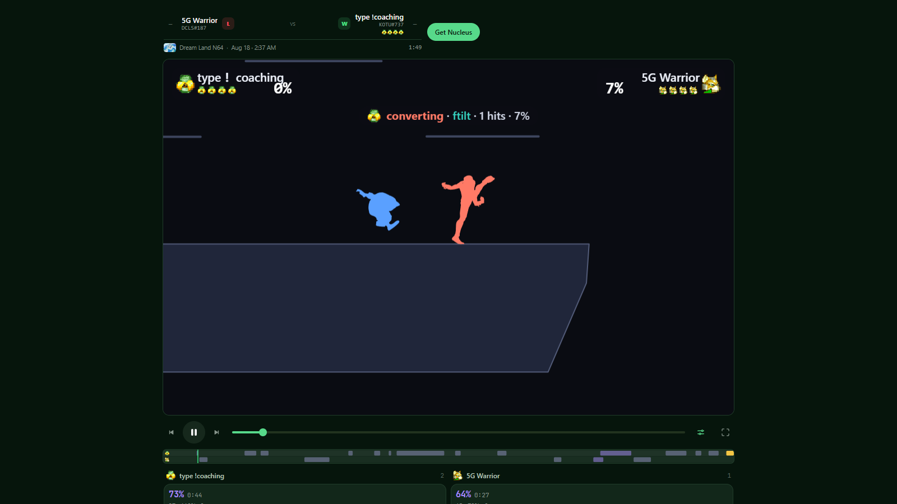

Open the replay at [ssbmnucleus.net/replay/kgck9a61gy1s](https://ssbmnucleus.net/replay/kgck9a61gy1s).

## Nucleus on your phone

Everything Tracker knows about your games, in your pocket. Pair once and your library syncs to [tracker.ssbmnucleus.net](https://tracker.ssbmnucleus.net), which installs to your Home Screen as **Nucleus** and opens like any other app — no app store, no install.

:::phones
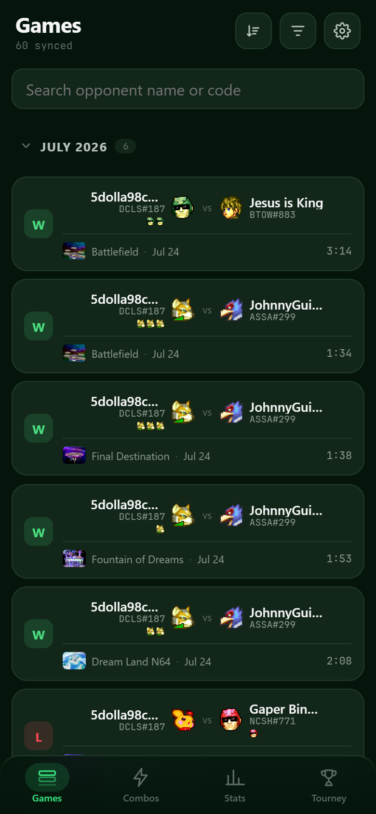
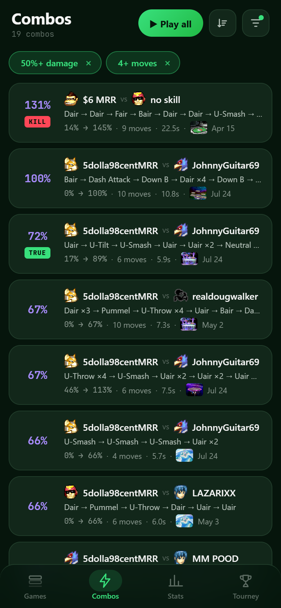
:::

:::phones
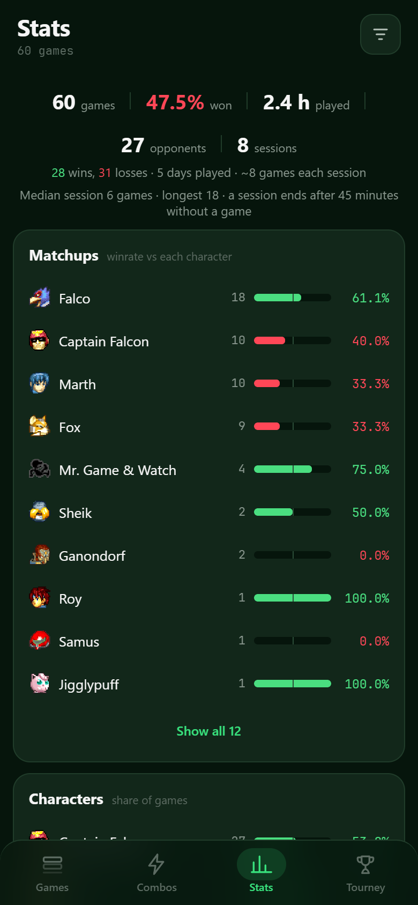
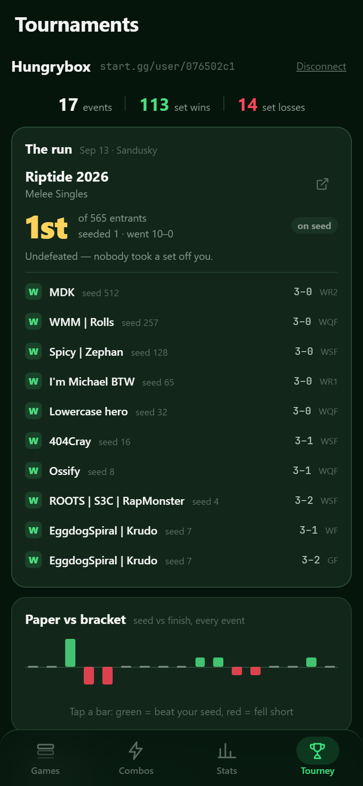
:::

- **Games.** Your whole library, grouped by month, with stocks, stage and result on every row. Search by opponent name or code.
- **Combos.** The same combos the desktop found, sorted by damage, filterable by character, move count and kills. **Play all** runs them back to back as a playlist, and any combo can be shared as a link.
- **Stats.** Win rates, matchups, stages, sessions and playtime, worked out on the phone from your synced games.
- **Tourney.** Your start.gg bracket runs, with seed-versus-finish for every event and your replays matched to the sets.
- **Replays play on the phone.** The same 2D view as **Lite** on desktop — projectiles, moving platforms, Stadium transformations, real shield sizes — with input display and action overlays. No Dolphin and no video files, so a game is a couple of hundred kilobytes.

The game list, combos and stats live on the phone once synced, so they open instantly and keep working on tournament wifi.

**The phone app and whole-library sync come with any paid Patreon tier, from $5/month.** Open desktop **Settings → Cloud** and press **Link Patreon**; the card at the top then shows what your account includes and the next step (join free, get the $5 tier, or pair your phone). Pick a tier at [patreon.com/cw/ssbmSc00p/membership](https://www.patreon.com/cw/ssbmSc00p/membership). A free Patreon membership already unlocks replay sharing; a Follow is not a membership, so choose **Join**. Paying also pays for the app's development.

Once you're on a paid tier, Nucleus turns on **Process new replays** and **Sync to your cloud library** for you (unless you set them yourself) and starts uploading.

### Pairing your phone

**Settings → Cloud** on desktop is what uploads your library (the **Cloud library** card shows the progress).

1. **On desktop:** get Tracker fully set up first — point it at your replay folder and let it finish indexing your games.
2. **On your phone:** open [tracker.ssbmnucleus.net](https://tracker.ssbmnucleus.net).
3. **On your phone:** add it to your Home Screen, then close your browser. Open it from the Home Screen shortcut from now on, not from a browser tab.
4. **On desktop:** open **Settings → Cloud** and press **Pair your phone** in the card at the top. A QR code appears.
5. **On your phone:** open Nucleus from the Home Screen and scan the QR code on your desktop screen.

That's it. Your replays start uploading — with a big library this takes a while, and you can watch the progress in **Settings → Cloud**. Keep desktop Nucleus open while it runs; **Sync now** starts a sync by hand.

The QR code expires after two minutes; **Pair your phone** again for a new one. **Mobile setup guide** in the Cloud library card shows these steps in the app.

If your membership ends, the phone stays paired and keeps what it already has; renew on Patreon and syncing picks up again.

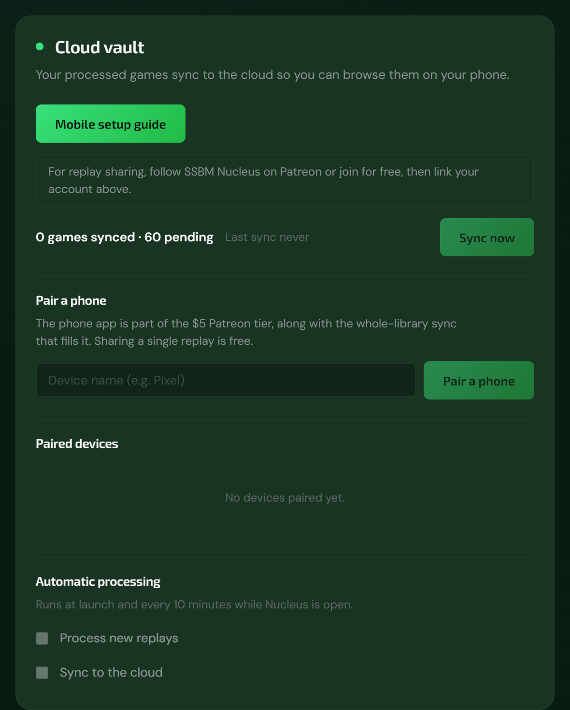

The phone app before pairing, with the scan button and the subscribe link:

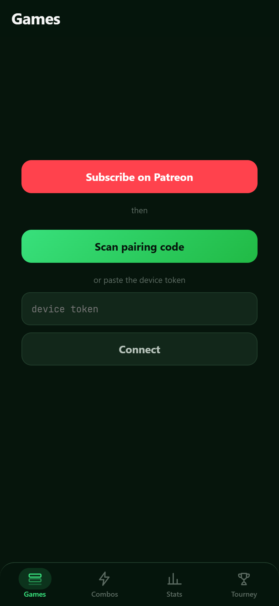
