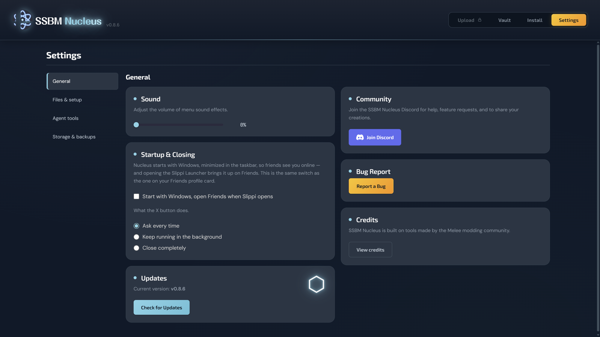
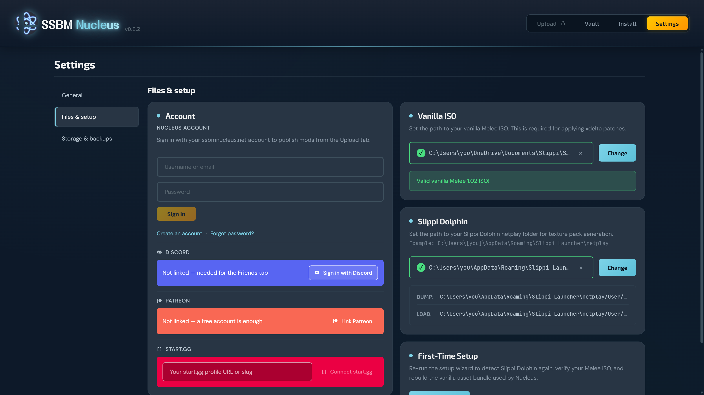

# 9. Settings

## General

- **Sound**: app sound effects and volume.
- **Updates**: check for and install updates. A gold dot on the Settings tab means one is waiting.
- **Community**: the Discord.
- **Bug Report**: see [Troubleshooting](10-troubleshooting.md).
- **Credits**.

## Files & setup

- **Account**: sign in with your website account for Upload. Link Discord to publish and report bugs as yourself, Patreon for cloud features, start.gg for Tournaments.
- **Vanilla ISO** and **Slippi Dolphin**: the two paths from first run.
- **First-Time Setup**: run setup again.

## AI

- **Connect your own AI (MCP)**: the command that adds Nucleus to Claude Code, Codex or Claude Desktop.
- **Model import tools**: the one-time download (Blender and a Python setup) that importing a 3D model as a costume needs.
- **Creation toolkit**: porting fighters from other games and building custom stages run from a copy of Nucleus's source you set up once; **Setup guide** opens the steps.

## Storage & backups

- **Data location**: where Nucleus keeps the Vault, projects, build output and extracted assets. **Choose drive or parent folder…** then **Schedule move for next launch** moves everything to a new drive; the copy is verified before anything is removed, and replay folders and ISOs stay where they are.
- **Vault Backup & Restore**: the Vault as one zip. Restore by **Merge** or **Replace**.
- **Texture Pack**: size of the Dolphin texture pack, and a button to clear it.
- **Storage Statistics**.
- **Clear Storage**: deletes the whole Vault. Projects and exported ISOs are kept.

## Tracker settings

Tracker adds a **Cloud** category: what your Patreon account includes (with **Link Patreon** right there), phone pairing, your **Cloud library** and its upload progress, and **Process new replays**, which works with or without Patreon. See [Tracker](08-tracker.md).
