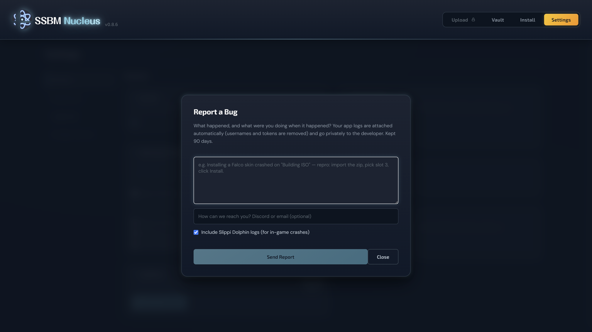

# 10. Troubleshooting

## Report a bug

**Settings → General → Bug Report → Report a Bug**. Say what happened and how to reproduce it. Logs are attached for you; tick the Dolphin logs option for in-game problems.

## "Windows Smart App Control blocked …"

On Windows 11 with Smart App Control turned on, Windows blocks a program file it does not trust. When this happens to a file that comes with Nucleus, Nucleus names the file and stops that step. Older versions showed only Windows error 0x800711C7, often when creating a project. Nucleus signs its installer but not every file inside it, and Smart App Control has no exception for a single app, so that step only runs with Smart App Control turned off (Windows Security > App & browser control). Windows explains what turning it off means before you do. Report it with **Report a Bug** so we know which file it was.
